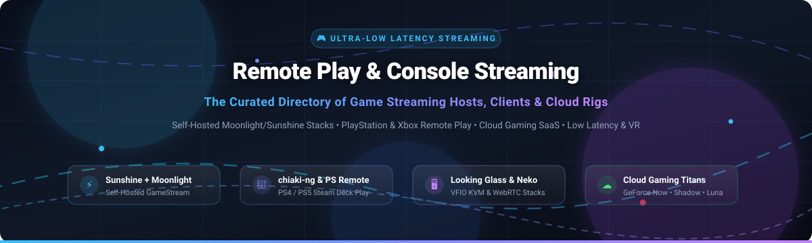

# 🎮 Awesome Remote Play & Console Streaming Utilities

  

  
  
  
  
  
  

---

## 📑 Overview & SEO Keywords

A curated collection of the best **Remote Play software**, **game streaming utilities**, **console streaming apps**, and **cloud gaming SaaS platforms**. Whether you are building a self-hosted **Moonlight and Sunshine** rig on Windows/Linux, streaming your **PlayStation 5 (PS5)** to a Steam Deck with **chiaki-ng**, enjoying low-latency couch co-op via **Parsec**, or deploying high-performance cloud gaming machines with **NVIDIA GeForce NOW**, **Shadow PC**, and **Xbox Cloud Gaming**, this list covers the ultimate tools for low-latency interactive streaming.

> **Keywords:** Remote Play, Console Streaming, Game Streaming, Cloud Gaming, Self-Hosted GameStream, Sunshine Host, Moonlight Client, Chiaki-ng, PS5 Remote Play, Xbox Cloud Gaming, GeForce NOW, Looking Glass KVM, WebRTC Game Streaming, Virtual Desktop, DualSense Haptics Streaming, Low Latency 60FPS/120FPS Streaming.

---

## 🧭 Table of Contents

- [📊 Sector Overview & Market Dynamics](#-sector-overview--market-dynamics)
- [☁️ SaaS & Hosted Cloud Gaming Platforms](#️-saas--hosted-cloud-gaming-platforms)
- [💻 Open-Source GitHub Projects](#-open-source-github-projects)
  - [🚀 Top Open-Source Streaming Ecosystem (Ranked by Stars)](#-top-open-source-streaming-ecosystem-ranked-by-stars)
  - [🖥️ PC Game Streaming (Host & Client)](#️-pc-game-streaming-host--client)
  - [🎮 PlayStation & Console Remote Play](#-playstation--console-remote-play)
  - [⚡ Low-Latency KVM & Virtualization Display Tools](#-low-latency-kvm--virtualization-display-tools)
  - [🌐 WebRTC, Containerized & VR Streaming](#-webrtc-containerized--vr-streaming)
  - [🛠️ Console Tooling & Protocol Libraries](#️-console-tooling--protocol-libraries)
- [🤝 How to Contribute](#-how-to-contribute)
- [⚖️ Disclaimer](#️-disclaimer)

---

## 📊 Sector Overview & Market Dynamics

The global cloud gaming and remote interactive streaming market was valued at approximately **$5.7 billion in 2024** and is projected to surge past **$25.0 billion by 2030**, exhibiting a robust CAGR exceeding 30%. 

The market dynamics present a **bifurcated, moderately concentrated landscape**:
- **Commercial Cloud Gaming (Infrastructure-Intensive)** is heavily concentrated around big-tech hyperscalers and GPU giants (NVIDIA, Microsoft, Sony, Amazon) who leverage massive global edge data centers, proprietary network fabrics, and AAA publisher content licensing ("winner-take-most" dynamics).
- **Self-Hosted Remote Play & Local Game Streaming** is highly dynamic and open-source driven. With enthusiasts streaming from their own high-end gaming PCs and consoles to portable devices (like Steam Deck, ROG Ally, smartphones, Apple Vision Pro, and Apple Silicon Macs), open protocols like Moonlight/Sunshine and chiaki-ng dominate due to zero subscription costs, sub-frame encode latency, AV1/HEVC support, and uncompressed local bitrate fidelity.

---

## ☁️ SaaS & Hosted Cloud Gaming Platforms

The table below highlights commercial game streaming and remote play services, sorted in descending order by parent company scale (valuation / market capitalization).

| 🏷️ Platform | 🏢 Company / Backer | 📈 Company Scale (Valuation / MCap) | 💵 Starting Tier Price | 🎁 Free Tier / Free Trial Limits | 📌 Key Focus & Capabilities |
| :--- | :--- | :--- | :--- | :--- | :--- |
| **[NVIDIA GeForce NOW](https://www.nvidia.com/en-us/geforce-now/)** | NVIDIA Corporation | **~$3.5 Trillion** (Market Cap) | **$9.99/month** (Performance Tier, 1440p 60FPS) | **Free Forever Tier**: 1-hour session length limit, standard rig access, ad-supported queue | Premium cloud gaming rigs (up to RTX 4080/4K 240FPS) connecting to Steam, Epic, Ubisoft & Xbox PC libraries. |
| **[Xbox Cloud Gaming](https://www.xbox.com/en-US/play)** | Microsoft Gaming | **~$3.1 Trillion** (Market Cap) | **$19.99/month** (Included in Xbox Game Pass Ultimate) | **Free Forever on Fortnite**: Play Fortnite cloud streaming 100% free with a free Microsoft account (no trial expiration) | High-performance console streaming direct from Microsoft Azure custom Xbox Series X server blades to any screen. |
| **[Amazon Luna](https://luna.amazon.com/)** | Amazon.com, Inc. | **~$2.1 Trillion** (Market Cap) | **$9.99/month** (Luna+ subscription) | **7-Day Free Trial** on Luna+ (unlimited gameplay hours during trial; Prime members also get a rotating free games bundle forever) | Seamless cloud gaming integrated with Twitch streaming, native Luna wireless controller direct-to-cloud Wi-Fi tech. |
| **[Sony PlayStation Remote Play](https://remoteplay.dl.playstation.net/)** | Sony Group Corporation | **~$110 Billion** (Market Cap) | **Free** ($0.00 base remote app; PS Plus Premium cloud streaming starts at **$17.99/month**) | **Free Forever Plan**: 100% free remote streaming from your owned PS4/PS5 consoles to iOS, Android, Windows, Mac & PS Portal | Official remote streamer for PlayStation hardware; provides native DualSense haptic feedback and adaptive trigger passthrough. |
| **[Boosteroid](https://boosteroid.com/)** | Boosteroid / Ivan Shvaichenko | **~$200 Million** (Private Valuation) | **€9.89/month** (~$10.70/mo for Standard 1080p) or €14.89/mo (Ultra 4K) | **No Free Forever Tier**: Occasional promotional 1-day/3-day trials ($1.99 or partner codes), otherwise paid access only | European and US browser-based & app-based cloud gaming service streaming PC games from Steam, Epic, and Battle.net. |
| **[Shadow PC](https://shadow.tech/)** | Octave Klaba / OVHcloud ecosystem | **~$150 Million** (Acquisition Valuation) | **$19.99/month** (Shadow Boost / Starter) or $32.99/month (Power Tier) | **No Free Tier**: Full refund within 14-day statutory EU withdrawal window; no recurring free plan | Full virtual Windows 10/11 gaming PC in the cloud with dedicated GPU passthrough, full modding, and peripheral redirection. |
| **[Parsec](https://parsec.app/)** | Unity Technologies (Parent MCap ~$8B) | **~$320 Million** (Acquisition Valuation) | **$0.00/month** (Free Core tier; Parsec Warp starts at **$9.99/month**) | **Free Forever Plan**: Unlimited hours 60FPS remote desktop, low-latency BUD protocol, virtual controller support, peer-to-peer multiplayer couch play | Gold-standard ultra-low-latency remote desktop and peer-to-peer game streaming engineered specifically for real-time interactive gaming. |
| **[Steam Link & Remote Play](https://store.steampowered.com/remoteplay)** | Valve Corporation | **~$8 Billion** (Private Valuation) | **Free** ($0.00 / 100% free software) | **Free Forever Plan**: Unlimited 100% free streaming from your host PC to mobile, Smart TVs, Steam Link hardware, or friend PCs (Remote Play Together) | Built-in Steam streaming protocol supporting hardware NVENC/AMF/QuickSync encoding, touch overlays, and multi-user remote party couch co-op. |

---

## 💻 Open-Source GitHub Projects

Open source is the undisputed engine of self-hosted game streaming. Below are the leading community projects, protocol implementations, and clients.

### 🚀 Top Open-Source Streaming Ecosystem (Ranked by Stars)

| 🌟 Stargazers Badge | 📦 Repository & Project | 📝 Description | 🏷️ Category |
| :---: | :--- | :--- | :--- |
|  | **[LizardByte/Sunshine](https://github.com/LizardByte/Sunshine)** | The leading self-hosted game stream host for Moonlight. Low-latency capture with hardware encoding (NVENC, AMD AMF, Intel QuickSync, VA-API) on Windows, Linux, and macOS. | Host |
|  | **[m1k1o/neko](https://github.com/m1k1o/neko)** | A self-hosted virtual browser and desktop that runs in Docker and streams via ultra-low-latency WebRTC with synchronized multi-user audio and video. | WebRTC / Browser |
|  | **[moonlight-stream/moonlight-qt](https://github.com/moonlight-stream/moonlight-qt)** | The official GameStream / Sunshine desktop client for Windows, macOS, Linux, and Steam Link. Supports 4K 120FPS, HDR, and surround sound. | Client |
|  | **[ClassicOldSong/Apollo](https://github.com/ClassicOldSong/Apollo)** | Optimized fork of Sunshine designed for seamless dynamic client-resolution matching, virtual display driver automation, and enhanced HDR. | Host |
|  | **[alvr-org/ALVR](https://github.com/alvr-org/ALVR)** | Stream PC VR games from your computer to standalone VR headsets (Meta Quest, Apple Vision Pro, Pico) via Wi-Fi with ultra-low latency. | VR Streaming |
|  | **[moonlight-stream/moonlight-android](https://github.com/moonlight-stream/moonlight-android)** | High-performance Moonlight GameStream client implementation for Android devices, Android TV, and handheld gaming consoles (Odin, Retroid). | Client |
|  | **[gnif/LookingGlass](https://github.com/gnif/LookingGlass)** | Extremely low-latency KVMFR (KVM FrameRelay) video passthrough for dual-GPU VFIO virtual machine setups without physical display switch latency. | KVM / VM Passthrough |
|  | **[ant-media/Ant-Media-Server](https://github.com/ant-media/Ant-Media-Server)** | Ultra-low latency streaming engine utilizing WebRTC (~0.5s latency), SRT, RTMP, and CMAF with adaptive bitrate transcoding for cloud game broadcast. | WebRTC Engine |
|  | **[streetpea/chiaki-ng](https://github.com/streetpea/chiaki-ng)** | The next-generation open-source PlayStation Remote Play client for PS4 & PS5 with HDR, 1080p 60FPS, haptic feedback, and Steam Deck optimizations. | Console Client |
| ** | **[selkies-project/selkies](https://github.com/selkies-project/selkies)** | Low-latency WebRTC accelerated remote desktop & cloud gaming platform for self-hosting in Docker, Kubernetes, and HPC bare metal. | WebRTC / Cloud Host |
|  | **[games-on-whales/wolf](https://github.com/games-on-whales/wolf)** | High-performance HTML5 and Moonlight-compatible streaming server focused on running isolated containerized games using Docker. | Host / Container |
|  | **[thestr4ng3r/chiaki](https://github.com/thestr4ng3r/chiaki)** | The original pioneer open-source PlayStation Remote Play client for Linux, macOS, and Windows. (Predecessor to chiaki-ng). | Console Client |
|  | **[moonlight-stream/moonlight-ios](https://github.com/moonlight-stream/moonlight-ios)** | GameStream and Sunshine client designed for iOS, iPadOS, and tvOS with ProMotion 120Hz and controller rumble. | Client |
|  | **[moonlight-stream/moonlight-embedded](https://github.com/moonlight-stream/moonlight-embedded)** | Lightweight embedded GameStream client targeting Raspberry Pi, ODROID, and resource-constrained single board computers. | Client |
|  | **[games-on-whales/gow](https://github.com/games-on-whales/gow)** | Games on Whales base infrastructure: containerized desktop applications, Steam, and emulation suites ready for remote streaming. | Container Suite |
|  | **[moonlight-stream/moonlight-common-c](https://github.com/moonlight-stream/moonlight-common-c)** | Core C protocol parsing and cryptographic handshake library underpinning all official Moonlight clients. | Protocol Library |
|  | **[slaughterhousesoftware/shimmer](https://github.com/slaughterhousesoftware/shimmer)** | Native Swift client for macOS combining Sunshine PC game streaming and PS5 Remote Play with Picture-in-Picture and DualSense haptics. | Dual Client |

---

### 🖥️ PC Game Streaming (Host & Client)

- **[Sunshine](https://github.com/LizardByte/Sunshine)**  
    
  *Self-hosted game stream host for Moonlight.* Operates as a background system service on Windows, Linux, and macOS with hardware-accelerated video encoders (NVIDIA NVENC, AMD AMF, Intel QSV).

- **[Moonlight Qt](https://github.com/moonlight-stream/moonlight-qt)**  
    
  *Cross-platform desktop client for Windows, macOS, and Linux.* Provides lowest-in-class display latency, HDR10 pass-through, and up to 120+ FPS high refresh rate gaming.

- **[Apollo](https://github.com/ClassicOldSong/Apollo)**  
    
  *Sunshine fork engineered for native resolution switching.* Automatically configures host virtual displays to match client aspect ratios and refresh rates on the fly.

- **[Moonlight Mobile & Embedded Suite](https://github.com/moonlight-stream)**  
      
  *Client ports for Android, iOS/tvOS, and Raspberry Pi/SBCs.* Complete GameStream protocol compatibility for smartphones, tablets, handheld consoles, and embedded Linux boxes.

---

### 🎮 PlayStation & Console Remote Play

- **[chiaki-ng](https://github.com/streetpea/chiaki-ng)**  
    
  *Next-Generation Chiaki PlayStation client.* The gold standard for PS4 and PS5 streaming on Steam Deck, Linux, Windows, macOS, and Android. Features HDR support, automated wake-on-LAN, gyro control, and DualSense trigger emulation.

- **[Chiaki (Original)](https://github.com/thestr4ng3r/chiaki)**  
    
  *The groundbreaking open-source PlayStation Remote Play client.* First to reverse-engineer and implement the Sony Remote Play protocol on non-Sony devices.

- **[Shimmer](https://github.com/slaughterhousesoftware/shimmer)**  
    
  *Native macOS dual client.* Stream games from your PC (Sunshine) or PlayStation 5 (chiaki-ng protocol) on Apple Silicon Macs with Picture-in-Picture windowing and full DualSense haptics.

---

### ⚡ Low-Latency KVM & Virtualization Display Tools

- **[Looking Glass](https://github.com/gnif/LookingGlass)**  
    
  *Shared memory KVM frame relay for VFIO.* Allows Linux hosts to display a Windows VM with dedicated GPU passthrough with sub-millisecond overhead through shared IVSHMEM memory buffers.

- **[Wayland & PipeWire Modern Linux Stacks](https://github.com/LizardByte/Sunshine)**  
  *Native screen capture modern foundations.* Direct PipeWire, dmabuf, and KMS screen capture implementations integrated into host daemons for stutter-free Wayland desktop streaming.

---

### 🌐 WebRTC, Containerized & VR Streaming

- **[Neko](https://github.com/m1k1o/neko)**  
    
  *Self-hosted virtual browser & desktop using WebRTC.* Watch movies or play interactive casual games with friends in a collaborative containerized browser room.

- **[ALVR](https://github.com/alvr-org/ALVR)**  
    
  *Air Light VR open-source streamer.* High-performance wireless VR streaming from PCVR headsets over Wi-Fi to standalone devices like Meta Quest, Apple Vision Pro, and Pico.

- **[Ant Media Server](https://github.com/ant-media/Ant-Media-Server)**  
    
  *Enterprise ultra-low-latency WebRTC streaming engine.* Powers real-time interactive experiences and cloud gaming video transport with sub-0.5 second latency.

- **[Selkies](https://github.com/selkies-project/selkies)**  
    
  *Low-latency web remote desktop platform.* Delivers accelerated desktop and 3D graphics streaming directly to standard web browsers via WebRTC without client app installs.

- **[Wolf (Games on Whales)](https://github.com/games-on-whales/wolf)**  
    
  *Stream gaming Docker containers.* Sunlight/Moonlight-compatible streaming daemon providing multi-tenant game containers directly on top of Linux.

---

### 🛠️ Console Tooling & Protocol Libraries

- **[Moonlight Common C](https://github.com/moonlight-stream/moonlight-common-c)**  
    
  *Core C library for GameStream protocol.* Handles audio/video packet depacketization, input serialization, RTSP control channels, and cryptographic session handshake.

- **[AnyPS5](https://github.com/boykopovar/AnyPS5)**  
  *PS5 binary relinker & porting experiments.* Exploratory developer tooling aimed at console executable analysis and library translation.

---

## 🤝 How to Contribute

Contributions are warmly welcome! Help keep this ecosystem guide up-to-date:

1. **Fork** the repository: `git checkout -b feature/new-streaming-utility`
2. **Add / update entries** in `README.md` following the tabular or categorized structure.
3. **Include details**: Tool name, official URL, pricing/free tier specifics (if SaaS), and GitHub star badge with `style=social&color=white` (if open source).
4. **Submit a Pull Request** with a descriptive summary of your changes.

---

## ⚖️ Disclaimer

- This is a community-maintained curated educational directory. Product names, logos, and brands are property of their respective owners.
- Ensure compliance with PlayStation, Xbox, NVIDIA, Steam, and game publisher Terms of Service.
- Self-hosted streaming performance depends heavily on local hardware encoder capabilities (NVENC/AMF/QSV) and network conditions (Ethernet/Wi-Fi 6E/5GHz).

---

  Built with ❤️ for PC and console gamers seeking ultra-low-latency remote play and true hardware ownership.

